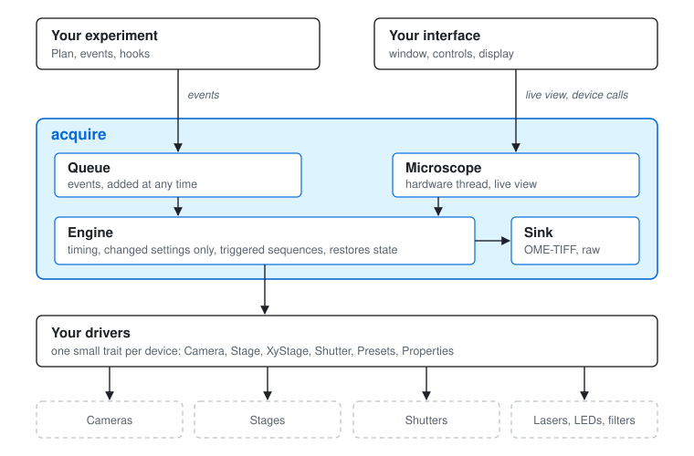

# acquire

More and more labs write their own microscope software. Every setup has its own cameras, stages and light sources and its own way of running an experiment, and with AI coding agents a researcher can now write the drivers and the user interface for their own setup.

The part in the middle is still hard to get right: starting each image at the right time, sending only the settings that changed, running Z stacks as triggered sequences, keeping slow devices off the GUI thread, putting the hardware back after a run, and saving data that Fiji and napari can open. It is also the same in every lab.

acquire is that middle part, as a Rust library. You write the drivers and the interface for your setup, and acquire runs the acquisition.



Rust suits this kind of work now that much of the code is written with AI agents. The compiler checks what the agent wrote, so type errors and data races show up when the program is built rather than halfway through an experiment. Cargo fetches the dependencies and builds the program the same way on Windows and Linux, so a new machine needs nothing more than `cargo run`. And Rust runs at native speed without garbage collection pauses, which matters when a camera delivers 8 MB frames a hundred times a second.

## Example

```rust
use acquire::*;

fn main() -> Result<()> {
    // Two positions, 11 Z planes, two channels, 10 time points one second apart
    let plan = Plan {
        cameras: vec!["Cam".into()],
        time_points: 10,
        interval_ms: 1000.0,
        positions: vec![
            Position { x: 0.0, y: 0.0, ..Default::default() },
            Position { x: 500.0, y: 0.0, ..Default::default() },
        ],
        z_positions: (-5..=5).map(|z| z as f64).collect(),
        channel_group: "Channel".into(),
        channels: vec![
            Channel { preset: "DAPI".into(), ..Default::default() },
            Channel { preset: "GFP".into(), exposure_ms: Some(50.0), ..Default::default() },
        ],
        ..Default::default()
    };
    let queue = Queue::new();
    queue.submit(plan.events());
    queue.close();

    let mut hw = sim::hardware();
    let mut sink = Buffered::new(OmeTiffSink::create("data")?, 16);
    run(&mut hw, &queue, &mut sink, &mut [])?;
    Ok(())
}
```

This runs on the simulated microscope in `acquire::sim` and writes `data/Cam.ome.tif`, which opens in Fiji with all its axes. Replace `sim::hardware()` with your own devices to run it on a real microscope.

## Triggered sequences

If the camera and the focus drive support sequences, a Z stack is taken as one triggered sequence instead of moving and snapping plane by plane. Output of `cargo run --example plan` with 5 ms exposures:

```
step of 5 event(s)
  #0   t=0 p=0 c=Some("DAPI") z=Some(-2.0)      5.1 ms
  #1   t=0 p=0 c=Some("DAPI") z=Some(-1.0)     10.2 ms
  #2   t=0 p=0 c=Some("DAPI") z=Some(0.0)     15.3 ms
  #3   t=0 p=0 c=Some("DAPI") z=Some(1.0)     20.4 ms
  #4   t=0 p=0 c=Some("DAPI") z=Some(2.0)     25.5 ms
step of 1 event(s)
  #5   t=0 p=0 c=Some("FITC") z=Some(0.0)     33.6 ms
```

With a Hamamatsu ORCA-Flash4.0 we record full 2048×2048 frames at 98 fps with live view running.

## Features

- Time, position, channel and Z plans, or your own list of events
- Events can be added during a run, so an acquisition can react to its images
- Hooks for autofocus and other custom steps
- `Microscope` runs the hardware on a background thread for programs with a GUI, with live view
- OME-TIFF and raw binary output
- Simulated devices, so you can develop without hardware

## Writing drivers

Each device implements a small trait. A camera needs `id`, `set_exposure` and `snap`, plus a few more methods if it can stream. [AGENTS.md](AGENTS.md) covers the details and is written so that an AI coding agent can follow it.

## Examples

```
cargo run --example plan       # the run above
cargo run --example adaptive   # Z stacks only where the overview is bright
cargo run --example live       # live view, then an acquisition in the background
```

## License

MIT or Apache-2.0, at your option.
